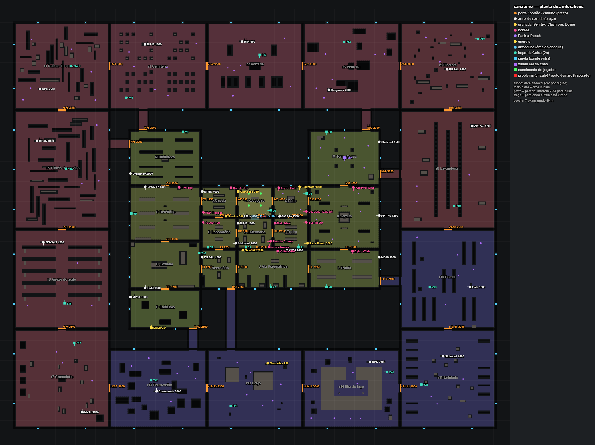
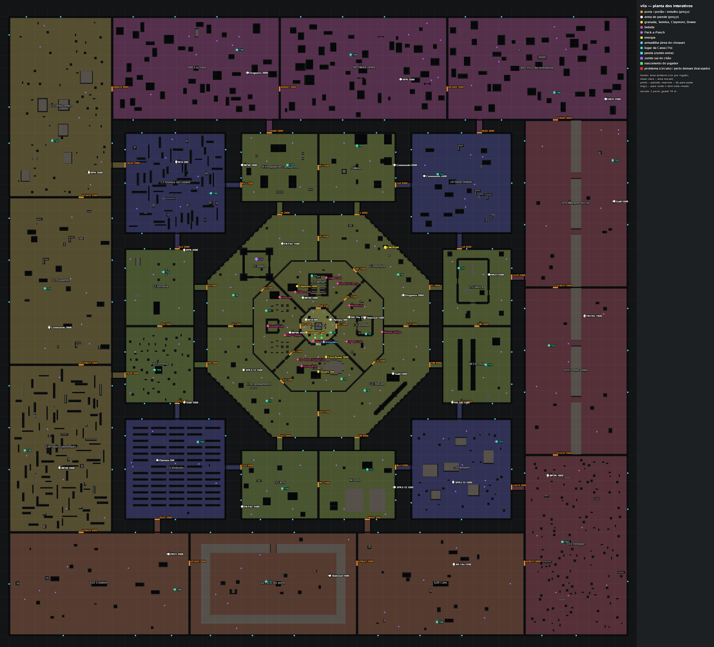

# Auditoria dos itens e interativos (Onda 2, Frente C, passo 1: O2-C01)

Base: `overhaul-zumbi` em `61c753a`. Nada foi redistribuído nem criado; este documento é o retrato atual e as regras propostas para as próximas etapas.

Feito com o jogo de verdade: `tools/itens/auditoria.mjs` abre o `index.html` num Chromium (placa de vídeo), cria a sala zumbi como host, trava o relógio e lê o mundo já montado (`ZD = M.z`, `COL`, `ZC.world`). A grade dos zumbis que a ferramenta pinta foi conferida contra o `zBuildWalk` do jogo: **idêntica nos dois mapas**.

Plantas (vista de cima, itens marcados, problemas em vermelho):

- Sanatório: 
- Vila: 

## 1. Resumo

| | Sanatório | Vila |
|---|---|---|
| Portas pagas (750 a 4000) | 40 | 54 |
| Armas de parede (+ letais e Bowie) | 28 + 6 | 34 + 4 |
| Bebidas | 13 (todas) | 13 (todas) |
| Pack-a-Punch / Energia / Armadilhas | 1 / 1 / 1 | 1 / 1 / 1 |
| Lugares da Caixa | 25 | 33 |
| Janelas / zumbis que saem do chão | 78 / 83 | 152 / 176 |
| Nascimentos do jogador | 4 | 4 |
| Lâmpadas (decoração; nenhuma é interativa) | 44 | 55 |
| Regiões (zoneAt) | 29 (15 escritas à mão + 14 geradas) | 33 (9 do octógono + 8 distritos + 16 geradas) |
| Achados: erros / avisos | 2 / 5 | 0 / 4 |

**O que não existe hoje** (para as próximas etapas não procurarem): interruptores de luz, terminais, barris, armadilhas de fogo, atalhos, barricadas além das janelas, máquinas de upgrade além do PaP. A única "alavanca" é a Energia (liga bebidas, PaP e armadilhas, uma vez) e a alavanca da armadilha elétrica. Os mapas PvP (`arena`, `dust`, `armazem`, `favela`, `neve`) **não têm nenhum item no chão** (só nascimentos e compra pelo menu).

### Power-ups (não têm ponto fixo)
`zDrop` não usa lugar do mapa: o power-up cai **onde o zumbi morreu** (`zKill`). Se o zumbi estava na janela (`out`/`tear`/`climb`), cai no ponto de dentro da janela (`ix, iz`), então nunca fica do lado de fora. O tipo sai de um saco embaralhado (`max, insta, dbl, nuke, carp, fire, death, zblood, bonus` + `bonfire` com energia + `perk` a partir da rodada 5 com 30%); no máximo 4 por rodada; limiar de pontos ×1,14 a cada drop, ou 2% por abate; o Carniceiro e o último cão sempre soltam. Fica 26 s, coleta a 1,6 m. O Vulture Aid solta carniça no mesmo ponto. **Não há nada a redistribuir aqui**; o que a ferramenta não confere é se o zumbi morreu em cima de algo (raríssimo: ele anda na grade livre).

### Onde cada coisa vem no código
| Item | Dados | Montagem / uso |
|---|---|---|
| Portas | `M.z.doors` (+ `SAN_GEN`/`VILA_DIST`/`VILA_GEN` via `zGenJoin`) | `zBuildWorld` (colisor 4×0,8×3,2), `srvZUse` `door` (≤ 3,2 m), `zInteract` (2,6 m) |
| Armas de parede, letais, Bowie | `M.z.wall` (geradas: uma por região, `spot(3,5)` com 80 tentativas e **plano B `[cx+3, cz+3]` sem conferência**) | giz no `zBuildWorld` (placa com colisor se `post`), `srvZUse` `wall` (≤ 2,6 m), F a 2 m |
| Bebidas | `M.z.perks` (uma por `k`) | máquina 1,1×0,9×2,2 com colisor, `srvZUse` `perk` (≤ 2,8 m), F a 2,2 m |
| Pack-a-Punch | `M.z.pap` | 1,6×1×1,8 com colisor, ≤ 3 m / F a 2,4 m |
| Energia | `M.z.power` | sem colisor, na parede, ≤ 3 m / F a 2,2 m |
| Armadilha | `M.z.traps` (área `x,z,w,d` + alavanca `sx,sz`) | `zTickTraps`, preço em `ZTRAP` (1000; 25 s; 60 s de recarga) |
| Caixa | `M.z.boxes` (índice 0 = início; geradas: uma por região) | `zBoxPlace` (colisor 1,8×0,9×0,9), muda de lugar em `zTickObjects` só para área aberta (`zoneAt(x+n, z+n)`) |
| Janelas / chão / jogador | `M.z.windows`, `risers`, `spawns` | `zSpawnOne`, `zSpawnPoint` |

## 2. Problemas encontrados, por gravidade

**Nenhum item crítico**: nenhum item atravessa parede ou outro objeto, nenhum desenho de giz ou alavanca está no ar, todo item tem lugar livre na frente e é alcançável a pé (com as portas abertas), nenhum item bloqueia passagem nem o campo de fluxo, todas as janelas e pontos do chão estão no campo dos zumbis, os lados de toda porta batem com as áreas que ela abre, a área inicial não vaza sem abrir porta, e todo lugar da Caixa aponta para uma área que alguma porta abre.

**Importantes (ERRO na ferramenta, mínimo de 3 m entre itens que se enxergam)**
1. Sanatório, Recepção: **Olympia (`parede:1`, 5,5; 7,45) a 2,4 m da alavanca da armadilha (`armadilha:0`, 3,1; 7,45)**, na mesma parede, lado a lado. O F escolhe o mais perto; na alavanca o Olympia "rouba" 21% dos pontos de uso. A Caixa inicial (`caixa:0`) também está a 3,8 m dos dois.
2. Sanatório, Enfermaria: **Quick Revive (7,3; 22,9) a 2,96 m do Electric Cherry (7,9; 20)**, no mesmo canto. Ainda dá para escolher cada um (nenhum fica sombreado), mas é o par de bebidas mais colado do jogo.

**Médios (avisos)**
3. Sanatório, Pátio: três itens com zumbi que **sai do chão a menos de 3 m** do ponto de uso: Claymore (`parede:19`, chao:2 a 1,9 m), Deadshot (chao:1 a 2,1 m) e Speed Cola (chao:0 a 2,7 m). Comprar ali é levar um zumbi nascendo no pé.
4. Sanatório, lugar da Caixa `caixa:16` (Anexo do asilo): quando a Caixa cai ali, estreita um vão e duas células (−95,5; 52,5) passam a ter 2,8 m de desvio. Não fecha caminho.
5. Vila, Fazenda: a máquina do **Mule Kick (24; −16)** estreita um vão do mesmo jeito (desvio de 2,8 m em 2 células, 25,5; −16,5). Não fecha caminho.

**Baixos: força × risco e cobertura**
6. **A força não acompanha o risco.** Correlação de Spearman entre a força do item (1 a 5) e o custo de portas até ele: 0,24 no Sanatório e 0,15 na Vila; com o caminho a pé: 0,16 / 0,15; com os pontos de nascimento de zumbi a 15 m: 0,01 / **−0,31** (na Vila os itens fortes ficam em lugares *mais* calmos). Exemplos:
   - Vila: **todas as 13 bebidas** ficam no octógono de dentro (A–E), a no máximo 1000 pontos de porta e 2 a 52 m do nascimento, inclusive Dying Wish (4000, a 26 m e 750 pontos), Mule Kick e Widow's Wine (4000, 1000 pontos), Speed Cola a 27 m. Faca Bowie (3000) a 17 m. O **PaP fica no pátio do Castelo sem nenhum ponto de nascimento a 15 m**.
   - Sanatório: Speed Cola (3000) no Pátio, a 13 m e 1000 pontos de porta.
   - A Energia fica longe nos dois (Sanatório: Caldeiras, 4500 pontos, 87 m; Vila: Pedreira, 2250 pontos, 91 m), o que está certo: ela libera tudo.
7. **Regiões grandes quase vazias.** Todas as regiões geradas (14 no Sanatório, 16 na Vila, mais os 8 distritos da Vila) têm só **uma arma de parede e um lugar de Caixa**, em 1200–2400 m² (Sanatório) e 2500–10600 m² (Vila). Os 4 cantos externos da Vila têm 8800–10600 m² cada com 1 arma. Nenhuma região sem item nenhum (o aviso de região vazia não disparou), mas a densidade cai de 1 item a cada 40–90 m² na área inicial para 1 a cada ~5000 m² nos cantos da Vila. As salas de fora não têm bebida, PaP, armadilha nem nada exclusivo: abrir 4000–11000 pontos de portas para chegar lá só rende uma arma que já existe perto do começo.
8. **Uma armadilha por mapa**, as duas na porta da área inicial (Sanatório: porta AB; Vila: porta AE). Nenhuma no resto do mapa.
9. Armas repetidas: no Sanatório MP40, AK-74u, Stakeout e MP5K aparecem 3 vezes; na Vila SPAS-12, FN FAL, Galil, MP40, Commando, HK21 e RPK aparecem 3 vezes cada.

## 3. Regras de distribuição propostas (com os números da ferramenta)

Os valores entre colchetes são as opções da ferramenta; ela já confere todas as regras marcadas com ✔.

1. ✔ **Distância mínima entre interativos que se enxergam: 3 m** [`--min 3`] (centro a centro). Entre bebidas, e entre um item e a Caixa: **5 m** desejável (a ferramenta lista tudo abaixo de 6 m [`--perto 6`]). Atrás de parede vale só o aviso. Porta não entra no mínimo, mas item a menos de 3 m do centro de porta deve ser evitado (o F da porta é 2,6 m).
2. ✔ **Nenhum item sombreado**: em pelo menos metade dos pontos livres dentro do raio do F, o item precisa ser o escolhido (abaixo de 50% é aviso; 0% é erro).
3. ✔ **Sem colisão**: o corpo (as caixas que o `zBuildWorld` põe no `COL`) não pode atravessar outra caixa em mais de 3 cm; giz e alavanca precisam de parede atrás (até 30 cm); lugar livre na frente para o raio do jogador (0,34 m).
4. ✔ **Nada bloqueia passagem**: comparando o campo de distância a pé (grade dos zumbis, portas abertas) com e sem os itens, nenhuma célula pode ficar sem caminho e nenhum desvio pode passar de **2 m** em mais de 4 células, nem de 4 m em nenhuma [`--desvio 2`]. Vale também para cada lugar da Caixa e para colisor novo de interativo novo (barricada, barril, terminal): se ele entra no `COL`, entra no teste.
5. ✔ **Nascimento de zumbi longe do balcão**: nenhuma janela (lado de dentro) nem ponto do chão a menos de **3 m** do ponto de uso [`--risco 3`]; para bebidas, PaP e Caixa, desejável 5 m.
6. ✔ **Alcance**: todo item alcançável a pé a partir do nascimento com as portas abertas, numa área que alguma porta abre; Caixa 0 na área inicial; `n` da Caixa apontando para dentro de área aberta.
7. **Cobertura por região** (✔ parcial: a ferramenta avisa região de 60 m² ou mais sem nada): toda região andável precisa de **pelo menos 1 interativo a cada 600 m²**, no mínimo 2 por região, e cada região de fora com **pelo menos 1 interativo próprio** (que não exista na área inicial nem nas vizinhas de até 1000 pontos de porta): bebida, armadilha, interruptor, terminal, atalho, máquina de upgrade.
8. **Força × risco** (a ferramenta calcula a correlação e avisa os fortes em lugar seguro): força 1–2 (armas até 1000, letais) pode ficar a até 1000 pontos de porta; força 3 a partir de 750; **força 4–5 (bebidas de 2500+, Bowie, Caixa fora do início, PaP) só com 2000+ pontos de porta ou com 3+ pontos de nascimento de zumbi a 15 m**. Meta: Spearman força × custo de portas **≥ 0,5** nos dois mapas (hoje 0,24 e 0,15). Exceções combinadas: Quick Revive perto do início (é a vida de quem joga sozinho) e a Caixa 0.
9. **Variedade**: nenhuma arma de parede repetida mais de 2 vezes por mapa; armadilhas espalhadas (pelo menos 1 por anel de regiões), não só na porta da área inicial.
10. **Toda tabela nova** (posição, preço, raio) fica nos dados do bloco, e o item novo entra no inventário da ferramenta: um tipo novo de interativo precisa ser acrescentado em `auditar()` (lista `itens`, com `corpo` = a caixa que ele põe no `COL`, `raio` do F e ponto de uso).

## 4. Interativos que já existem em cada mapa (não duplicar)

- **Sanatório**: 40 portas (portas de madeira, entulho, portões; 750–4000); 13 bebidas (todas as de `ZPERKS`) nos cômodos de dentro e nas alas K/L/G; PaP na Torre d'água (M); Energia nas Caldeiras (P); 1 armadilha elétrica na porta AB (Recepção ↔ Enfermaria); 25 lugares da Caixa (11 nos cômodos + 1 por região gerada); 34 compras de parede (28 armas, 3 granadas, Semtex, Claymore, Bowie no Teatro); 78 janelas com tábuas.
- **Vila**: 54 portas e portões (750–4000); 13 bebidas, todas no octógono de dentro (Igreja, Fazenda, Cemitério, Lago, Praça); PaP no Castelo (I); Energia na Pedreira (F, gerador); 1 armadilha elétrica no portão AE (Praça ↔ Lago); 33 lugares da Caixa (9 no octógono + distritos e regiões geradas); 38 compras de parede (34 armas, granadas, Semtex no Lago, Claymore na Igreja, Bowie no Lago); 152 janelas; fogueira do Acampamento (só luz, sempre acesa).
- **PvP**: nada.

## 5. Ferramenta: `tools/itens/auditoria.mjs`

```
node tools/itens/auditoria.mjs [--pagina index.html] [--mapas sanatorio,vila] [--min 3] [--perto 6] [--desvio 2] [--risco 3]
                               [--saida auditoria-itens.json] [--png docs/overhaul/img] [--gfx baixo] [--falhar-em erro|aviso] [--sem-gpu] [--quieto]
```

- Abre a página como o `bench.mjs` (servidor local, sem rede externa, placa de vídeo; `--sem-gpu` usa SwiftShader), monta cada mapa como host e trava o relógio (`__simLock`) antes de ler: nenhum zumbi nasce e a Caixa não muda durante a leitura. ~1 min por mapa.
- Imprime o inventário, os pares abaixo de `--perto`, o bloqueio, a correlação força × risco, as regiões e os achados; grava o JSON completo (`--saida`) e a planta (`--png`, `itens_<mapa>.png`).
- **Código de saída 1** com qualquer ERRO (ou aviso, com `--falhar-em aviso`). Hoje: **Sanatório falha** (os 2 pares do §2) e a Vila passa.
- Grades: zumbis = a mesma pintura do `zBuildWalk` (1 m, raio 0,45, caixas entre 5 cm e 1,7 m); jogador = 0,5 m, raio `PR` 0,34, só o que não dá para pular (`zHigh`). Distâncias por Dijkstra com o custo do `zFlowStep` (reto 5, diagonal 7, sem cortar quina), sem o limite de 160 m do jogo.
- Ganchos: com o diff `C01.diff` ela usa `zBuildWalk` (e confere que a grade é igual), `ZPERKS` (nomes e preços das bebidas) e `ZTRAP`; sem eles (HEAD atual) roda igual, só sem os nomes/preços das bebidas e sem o aviso de força.
- Testada com uma cópia sabotada (Quick Revive dentro da porta AB, Double Tap no vão da porta AF, M14 no meio da Recepção): acusou as duas colisões com o colisor das portas e o giz no ar (código 1). O Double Tap no vão não virou bloqueio, e está certo: a máquina tem 1,1 m e sobram 1,45 m de cada lado na porta de 4 m.
- **Para um tipo novo de interativo** (Frentes C e E): acrescente-o em `auditar()` na lista `itens` (`tipo`, `x/z/n`, `raio` do F, `corpo` com a caixa que ele põe no `COL` ou `parede` se for de parede, e o ponto de uso com `uso(o, distância)`), e em `forca()` e na legenda da planta.

## 6. Tabelas por mapa

Colunas: caminho a pé = metros desde o nascimento com tudo aberto (grade do jogador); portas = soma do preço das portas mais baratas até a região (grafo de `M.z.doors`, como o `zActive`); força 1–5 (arma até 500 = 1, até 1000 = 2, 1500 = 3, 2000+ = 4; letais 2; Bowie, Caixa 4; bebida 1500 = 2, 2000 = 3, 2500–3000 = 4, 4000 = 5; PaP 5; Energia e armadilha 3); nasc. a 15 m = janelas e pontos do chão até 15 m do ponto de uso.


### Sanatório

| id | tipo | nome | x; z | região | preço | caminho a pé (m) | portas (pts) | força | nasc. a 15 m | problemas |
|---|---|---|---|---|---|---|---|---|---|---|
| parede:0 | arma_parede | M14 | -5,5; 7,45 | A Recepção | 500 | 5,5 | 0 | 1 | 1 |  |
| parede:1 | arma_parede | Olympia | 5,5; 7,45 | A Recepção | 500 | 5,5 | 0 | 1 | 2 |  |
| parede:2 | letal | Granadas | -8,45; -5 | A Recepção | 250 | 5,4 | 0 | 2 | 3 |  |
| parede:3 | arma_parede | MP40 | -8,45; 11 | B Enfermaria | 1000 | 14,9 | 750 | 2 | 0 |  |
| parede:4 | arma_parede | AK-74u | 12,5; 7,45 | C Pátio | 1200 | 13,9 | 1000 | 2 | 3 |  |
| parede:5 | arma_parede | MP5K | -26,45; -5 | F Capela | 1000 | 25,4 | 750 | 2 | 1 |  |
| parede:6 | arma_parede | Stakeout | -9,55; 21 | D Laboratório | 1500 | 23,8 | 1750 | 3 | 0 |  |
| parede:7 | bowie | Faca Bowie | 26,45; 21 | E Teatro | 3000 | 34,2 | 2000 | 4 | 2 |  |
| parede:8 | arma_parede | SPAS-12 | -55; -7,45 | G Refeitório | 1500 | 55,2 | 2000 | 3 | 1 |  |
| parede:9 | arma_parede | Galil | -55; 43,45 | H Cozinha | 1500 | 75,1 | 3000 | 3 | 2 |  |
| parede:10 | arma_parede | Dragunov | -62,45; -14 | N Biblioteca | 2000 | 65 | 3000 | 4 | 3 |  |
| parede:11 | arma_parede | FN FAL | -26,45; 28 | I Necrotério | 1500 | 39,7 | 3000 | 3 | 0 |  |
| parede:12 | arma_parede | HK21 | 16; 24,55 | J Ala Psiquiátrica | 2500 | 39,2 | 2250 | 4 | 0 |  |
| parede:13 | letal | Granadas | -6; 24,55 | J Ala Psiquiátrica | 250 | 28,1 | 2250 | 2 | 0 |  |
| parede:14 | arma_parede | AK-74u | 62,45; 7 | K Jardim | 1200 | 61,3 | 2250 | 2 | 5 |  |
| parede:15 | arma_parede | MP40 | 62,45; 28 | L Estufa | 1000 | 73,3 | 3250 | 2 | 4 |  |
| parede:16 | arma_parede | Stakeout | 62,45; -30 | M Torre d'água | 1500 | 73,9 | 3750 | 3 | 4 |  |
| parede:17 | arma_parede | MP5K | -62,45; 48 | P Caldeiras | 1000 | 84,3 | 4500 | 2 | 3 |  |
| parede:18 | letal | Semtex | -14,5; 7,45 | F Capela | 500 | 15 | 750 | 2 | 1 |  |
| parede:19 | letal | Claymore | 22,5; -7,45 | C Pátio | 1000 | 22,7 | 1000 | 2 | 5 | nasce_em_cima |
| parede:20 | arma_parede | MP40 | -55,17; -78,94 | r1 Cemitério | 1000 | 124,6 | 5000 | 2 | 3 |  |
| parede:21 | arma_parede | M14 | -6,4; -80,36 | r2 Portaria | 500 | 155,1 | 7500 | 1 | 4 |  |
| parede:22 | arma_parede | Dragunov | 37,17; -56,17 | r3 Pedreira | 2000 | 109,9 | 5750 | 4 | 4 |  |
| parede:23 | arma_parede | RPK | -107,92; -56,56 | r4 Ruínas do convento | 2500 | 136,5 | 8000 | 4 | 3 |  |
| parede:24 | arma_parede | MP5K | -109,4; -30,57 | r5 Túneis de serviço | 1000 | 126 | 5250 | 2 | 1 |  |
| parede:25 | arma_parede | SPAS-12 | -106,21; 20,45 | r6 Anexo do asilo | 1500 | 152,4 | 7750 | 3 | 1 |  |
| parede:26 | arma_parede | HK21 | -86,63; 105,94 | r7 Crematório | 2500 | 168 | 11000 | 4 | 1 |  |
| parede:27 | arma_parede | FN FAL | 96,55; -66,38 | r8 Floresta | 1500 | 140,1 | 8750 | 3 | 2 |  |
| parede:28 | arma_parede | AK-74u | 109,2; -37,94 | r9 Lavanderia | 1200 | 129,5 | 6000 | 2 | 1 |  |
| parede:29 | arma_parede | Galil | 108,09; 42,93 | r10 Pomar | 1500 | 127,4 | 5750 | 3 | 3 |  |
| parede:30 | arma_parede | Stakeout | 94,53; 77,87 | r11 Estábulo | 1500 | 144,2 | 8750 | 3 | 1 |  |
| parede:31 | arma_parede | Commando | -49,36; 95,43 | r12 Ferro-velho | 2000 | 127 | 7000 | 4 | 2 |  |
| parede:32 | letal | Granadas | 6,53; 81,27 | r13 Brejo | 250 | 97,7 | 5250 | 2 | 3 |  |
| parede:33 | arma_parede | RPK | 57,89; 80,62 | r14 Ilha do lago | 2500 | 159,6 | 8250 | 4 | 3 |  |
| bebida:qr | bebida | Quick Revive | 7,3; 22,9 | B Enfermaria | 1500 | 22,7 | 750 | 2 | 0 |  |
| bebida:jug | bebida | Juggernog | -25,9; 10,5 | D Laboratório | 2500 | 26,2 | 1750 | 4 | 0 |  |
| bebida:speed | bebida | Speed Cola | 12; -6,9 | C Pátio | 3000 | 13,3 | 1000 | 4 | 5 | nasce_em_cima |
| bebida:dt | bebida | Double Tap | -12; -6,9 | F Capela | 2000 | 13,6 | 750 | 3 | 2 |  |
| bebida:stam | bebida | Stamin-Up | 25,9; 10,5 | E Teatro | 2000 | 25,7 | 2000 | 3 | 2 |  |
| bebida:phd | bebida | PhD Flopper | -25,9; 5,5 | F Capela | 2000 | 24,2 | 750 | 3 | 1 |  |
| bebida:ds | bebida | Deadshot Daiquiri | 25,9; 5 | C Pátio | 1500 | 23,5 | 1000 | 2 | 6 | nasce_em_cima |
| bebida:mule | bebida | Mule Kick | 10,1; 11 | E Teatro | 4000 | 22,9 | 2000 | 5 | 1 |  |
| bebida:cherry | bebida | Electric Cherry | 7,9; 20 | B Enfermaria | 2000 | 21 | 750 | 3 | 0 |  |
| bebida:vult | bebida | Vulture Aid | 11,5; 24,95 | J Ala Psiquiátrica | 3000 | 34,5 | 2250 | 4 | 0 |  |
| bebida:widow | bebida | Widow's Wine | 49,5; -7,05 | K Jardim | 4000 | 49,5 | 2250 | 5 | 6 |  |
| bebida:dying | bebida | Dying Wish | 49; 24,95 | L Estufa | 4000 | 59,8 | 3250 | 5 | 2 |  |
| bebida:slip | bebida | Timeslip | -38; -7,05 | G Refeitório | 2000 | 38 | 2000 | 3 | 0 |  |
| pap | pap | Pack-a-Punch | 45; -22 | M Torre d'água | 5000 | 58,3 | 3750 | 5 | 6 |  |
| energia | energia | Energia | -52; 63,45 | P Caldeiras | 0 | 87,3 | 4500 | 3 | 2 |  |
| armadilha:0 | armadilha | Armadilha elétrica | 3,1; 7,45 | A Recepção | 1000 | 4,5 | 0 | 3 | 1 |  |
| caixa:0 | caixa | Caixa misteriosa (início) | 7,95; 4,5 | A Recepção | 950 | 4,5 | 0 | 4 | 2 |  |
| caixa:1 | caixa | Caixa misteriosa | -4,5; 23,05 | B Enfermaria | 950 | 21,8 | 750 | 4 | 0 |  |
| caixa:2 | caixa | Caixa misteriosa | -23,5; 23,05 | D Laboratório | 950 | 34,7 | 1750 | 4 | 0 |  |
| caixa:3 | caixa | Caixa misteriosa | 22; 23,05 | E Teatro | 950 | 33,8 | 2000 | 4 | 0 |  |
| caixa:4 | caixa | Caixa misteriosa | 26,05; -4 | C Pátio | 950 | 24 | 1000 | 4 | 7 |  |
| caixa:5 | caixa | Caixa misteriosa | -62,05; 6 | G Refeitório | 950 | 60,9 | 2000 | 4 | 2 |  |
| caixa:6 | caixa | Caixa misteriosa | -36; -35,05 | N Biblioteca | 950 | 76,4 | 3000 | 4 | 3 |  |
| caixa:7 | caixa | Caixa misteriosa | 8; 43,05 | J Ala Psiquiátrica | 950 | 43,6 | 2250 | 4 | 2 |  |
| caixa:8 | caixa | Caixa misteriosa | 36; 43,05 | L Estufa | 950 | 65,6 | 3250 | 4 | 1 |  |
| caixa:9 | caixa | Caixa misteriosa | 36; -35,05 | M Torre d'água | 950 | 74,2 | 3750 | 4 | 5 |  |
| caixa:10 | caixa | Caixa misteriosa | -27,95; 26 | H Cozinha | 950 | 51,3 | 3000 | 4 | 0 |  |
| caixa:11 | caixa | Caixa misteriosa | -64,62; -52,18 | r1 Cemitério | 950 | 102,5 | 5000 | 4 | 1 |  |
| caixa:12 | caixa | Caixa misteriosa | 2,34; -73,76 | r2 Portaria | 950 | 151,3 | 7500 | 4 | 2 |  |
| caixa:13 | caixa | Caixa misteriosa | 44,74; -80,26 | r3 Pedreira | 950 | 124,6 | 5750 | 4 | 2 |  |
| caixa:14 | caixa | Caixa misteriosa | -92,45; -68,17 | r4 Ruínas do convento | 950 | 141,4 | 8000 | 4 | 2 |  |
| caixa:15 | caixa | Caixa misteriosa | -94,93; -16,46 | r5 Túneis de serviço | 950 | 115,5 | 5250 | 4 | 1 |  |
| caixa:16 | caixa | Caixa misteriosa | -95,54; 51,24 | r6 Anexo do asilo | 950 | 176 | 7750 | 4 | 1 |  |
| caixa:17 | caixa | Caixa misteriosa | -90,65; 70,99 | r7 Crematório | 950 | 177,6 | 11000 | 4 | 2 |  |
| caixa:18 | caixa | Caixa misteriosa | 112,02; -81,84 | r8 Floresta | 950 | 159,6 | 8750 | 4 | 4 |  |
| caixa:19 | caixa | Caixa misteriosa | 100,01; 2,19 | r9 Lavanderia | 950 | 117,7 | 6000 | 4 | 0 |  |
| caixa:20 | caixa | Caixa misteriosa | 87,81; 42,93 | r10 Pomar | 950 | 108,9 | 5750 | 4 | 2 |  |
| caixa:21 | caixa | Caixa misteriosa | 83,67; 92,01 | r11 Estábulo | 950 | 160,4 | 8750 | 4 | 2 |  |
| caixa:22 | caixa | Caixa misteriosa | -52,09; 89,67 | r12 Ferro-velho | 950 | 129,5 | 7000 | 4 | 4 |  |
| caixa:23 | caixa | Caixa misteriosa | -12,22; 102,73 | r13 Brejo | 950 | 107,5 | 5250 | 4 | 2 |  |
| caixa:24 | caixa | Caixa misteriosa | 66,33; 85,66 | r14 Ilha do lago | 950 | 169,9 | 8250 | 4 | 1 |  |

#### Portas

| id | tipo | x; z | preço | liga |
|---|---|---|---|---|
| AB | door | 0; 8 | 750 | A Recepção ↔ B Enfermaria |
| AC | debris | 9; 0 | 1000 | A Recepção ↔ C Pátio |
| AF | door | -9; 0 | 750 | A Recepção ↔ F Capela |
| BD | door | -9; 16 | 1000 | B Enfermaria ↔ D Laboratório |
| BE | door | 9; 16 | 1250 | B Enfermaria ↔ E Teatro |
| CE | debris | 18; 8 | 1000 | C Pátio ↔ E Teatro |
| FD | door | -18; 8 | 1000 | F Capela ↔ D Laboratório |
| FG | door | -27; 0 | 1250 | F Capela ↔ G Refeitório |
| GN | door | -45; -8 | 1000 | G Refeitório ↔ N Biblioteca |
| GH | door | -45; 20 | 1000 | G Refeitório ↔ H Cozinha |
| HP | debris | -45; 44 | 1500 | H Cozinha ↔ P Caldeiras |
| HI | door | -27; 34 | 1250 | H Cozinha ↔ I Necrotério |
| DI | door | -18; 24 | 1250 | D Laboratório ↔ I Necrotério |
| BJ | door | 0; 24 | 1500 | B Enfermaria ↔ J Ala Psiquiátrica |
| IJ | door | -9; 34 | 1000 | I Necrotério ↔ J Ala Psiquiátrica |
| CK | gate | 27; 0 | 1250 | C Pátio ↔ K Jardim |
| KL | door | 45; 24 | 1000 | K Jardim ↔ L Estufa |
| JL | door | 27; 34 | 1250 | J Ala Psiquiátrica ↔ L Estufa |
| KM | gate | 45; -8 | 1500 | K Jardim ↔ M Torre d'água |
| Nr1 | gate | -56; -36 | 2000 | N Biblioteca ↔ r1 Cemitério |
| Mr3 | gate | 56; -36 | 2000 | M Torre d'água ↔ r3 Pedreira |
| Nr5 | gate | -63; -29 | 2250 | N Biblioteca ↔ r5 Túneis de serviço |
| Mr9 | gate | 63; -14 | 2250 | M Torre d'água ↔ r9 Lavanderia |
| Lr10 | gate | 63; 40 | 2500 | L Estufa ↔ r10 Pomar |
| Pr12 | gate | -31; 64 | 2500 | P Caldeiras ↔ r12 Ferro-velho |
| Ir13 | gate | -12; 44 | 2250 | I Necrotério ↔ r13 Brejo |
| r1r2 | door | -24; -68 | 2500 | r1 Cemitério ↔ r2 Portaria |
| r2r3 | gate | 24; -68 | 2500 | r2 Portaria ↔ r3 Pedreira |
| r1r4 | debris | -73; -68 | 3000 | r1 Cemitério ↔ r4 Ruínas do convento |
| r3r8 | gate | 73; -68 | 3000 | r3 Pedreira ↔ r8 Floresta |
| r5r4 | door | -97; -46 | 3000 | r5 Túneis de serviço ↔ r4 Ruínas do convento |
| r5r6 | door | -97; 14 | 2500 | r5 Túneis de serviço ↔ r6 Anexo do asilo |
| r6r7 | debris | -97; 64 | 3500 | r6 Anexo do asilo ↔ r7 Crematório |
| r9r8 | door | 97; -46 | 3000 | r9 Lavanderia ↔ r8 Floresta |
| r9r10 | door | 97; 14 | 2500 | r9 Lavanderia ↔ r10 Pomar |
| r10r11 | door | 97; 64 | 3000 | r10 Pomar ↔ r11 Estábulo |
| r12r13 | debris | -24; 94 | 2500 | r12 Ferro-velho ↔ r13 Brejo |
| r13r14 | door | 24; 94 | 3000 | r13 Brejo ↔ r14 Ilha do lago |
| r12r7 | door | -73; 94 | 4000 | r12 Ferro-velho ↔ r7 Crematório |
| r14r11 | gate | 73; 94 | 4000 | r14 Ilha do lago ↔ r11 Estábulo |

#### Regiões

| região | portas até lá (pts) | m² andáveis | janelas | saem do chão | interativos |
|---|---|---|---|---|---|
| A Recepção | 0 | 229 | 2 | 0 | parede:0, parede:1, parede:2, armadilha:0, caixa:0 |
| B Enfermaria | 750 | 204 | 0 | 0 | parede:3, bebida:qr, bebida:cherry, caixa:1 |
| F Capela | 750 | 197 | 1 | 0 | parede:5, parede:18, bebida:dt, bebida:phd |
| C Pátio | 1000 | 216 | 1 | 3 | parede:4, parede:19, bebida:speed, bebida:ds, caixa:4 |
| D Laboratório | 1750 | 219 | 0 | 0 | parede:6, bebida:jug, caixa:2 |
| G Refeitório | 2000 | 786 | 2 | 0 | parede:8, bebida:slip, caixa:5 |
| E Teatro | 2000 | 193 | 0 | 0 | parede:7, bebida:stam, bebida:mule, caixa:3 |
| K Jardim | 2250 | 925 | 2 | 6 | parede:14, bebida:widow |
| J Ala Psiquiátrica | 2250 | 555 | 2 | 0 | parede:12, parede:13, bebida:vult, caixa:7 |
| N Biblioteca | 3000 | 758 | 3 | 0 | parede:10, caixa:6 |
| H Cozinha | 3000 | 679 | 2 | 0 | parede:9, caixa:10 |
| I Necrotério | 3000 | 278 | 1 | 0 | parede:11 |
| L Estufa | 3250 | 542 | 2 | 0 | parede:15, bebida:dying, caixa:8 |
| M Torre d'água | 3750 | 859 | 3 | 5 | parede:16, pap, caixa:9 |
| P Caldeiras | 4500 | 570 | 3 | 0 | parede:17, energia |
| r1 Cemitério | 5000 | 1832 | 3 | 6 | parede:20, caixa:11 |
| r5 Túneis de serviço | 5250 | 2218 | 5 | 3 | parede:24, caixa:15 |
| r13 Brejo | 5250 | 1706 | 3 | 6 | parede:32, caixa:23 |
| r10 Pomar | 5750 | 1983 | 4 | 6 | parede:29, caixa:20 |
| r3 Pedreira | 5750 | 1827 | 3 | 6 | parede:22, caixa:13 |
| r9 Lavanderia | 6000 | 2390 | 5 | 3 | parede:28, caixa:19 |
| r12 Ferro-velho | 7000 | 1566 | 3 | 6 | parede:31, caixa:22 |
| r2 Portaria | 7500 | 1757 | 4 | 6 | parede:21, caixa:12 |
| r6 Anexo do asilo | 7750 | 1853 | 4 | 3 | parede:25, caixa:16 |
| r4 Ruínas do convento | 8000 | 1651 | 4 | 6 | parede:23, caixa:14 |
| r14 Ilha do lago | 8250 | 1220 | 4 | 6 | parede:33, caixa:24 |
| r11 Estábulo | 8750 | 2044 | 4 | 3 | parede:30, caixa:21 |
| r8 Floresta | 8750 | 1821 | 4 | 6 | parede:27, caixa:18 |
| r7 Crematório | 11000 | 2082 | 4 | 3 | parede:26, caixa:17 |

#### Pares < 6 m

- parede:13 — caixa:1: 2,12 m (parede no meio)
- parede:1 — armadilha:0: 2,4 m **ERRO**
- parede:11 — caixa:10: 2,5 m (parede no meio)
- bebida:qr — bebida:cherry: 2,96 m **ERRO**
- porta:AB — armadilha:0: 3,15 m
- porta:FD — parede:18: 3,54 m
- parede:1 — caixa:0: 3,83 m
- parede:2 — bebida:dt: 4,03 m (parede no meio)
- porta:CK — caixa:4: 4,11 m
- porta:KL — bebida:dying: 4,11 m
- porta:BE — bebida:cherry: 4,15 m
- parede:4 — bebida:mule: 4,29 m (parede no meio)
- parede:12 — bebida:vult: 4,52 m
- porta:BJ — caixa:1: 4,6 m
- porta:KM — bebida:widow: 4,6 m
- porta:AC — caixa:0: 4,62 m
- parede:0 — parede:3: 4,62 m (parede no meio)
- bebida:qr — bebida:vult: 4,67 m (parede no meio)
- parede:7 — caixa:3: 4,9 m
- parede:19 — caixa:4: 4,95 m
- bebida:jug — bebida:phd: 5 m (parede no meio)
- parede:6 — parede:13: 5,02 m (parede no meio)
- porta:AF — parede:2: 5,03 m
- porta:BD — parede:3: 5,03 m
- porta:BD — parede:6: 5,03 m
- porta:FG — parede:5: 5,03 m
- porta:BE — bebida:mule: 5,12 m
- porta:CK — bebida:ds: 5,12 m
- parede:4 — caixa:0: 5,42 m (parede no meio)
- parede:6 — caixa:1: 5,45 m (parede no meio)
- bebida:stam — bebida:ds: 5,5 m (parede no meio)
- porta:AB — parede:0: 5,53 m (parede no meio)
- porta:AB — parede:1: 5,53 m (parede no meio)
- porta:CE — parede:4: 5,53 m (parede no meio)
- porta:DI — caixa:2: 5,58 m
- porta:FG — bebida:phd: 5,61 m
- armadilha:0 — caixa:0: 5,68 m
- parede:11 — caixa:2: 5,76 m (parede no meio)
- parede:1 — bebida:mule: 5,81 m (parede no meio)

#### Achados

- aviso [bloqueio] caixa:16: 0 célula(s) de 1 m ficam sem caminho e 2 com desvio > 2 m (máx 2.8 m em -95.5, 52.5); itens mais perto: {"caixa:16":2}
- erro [perto] parede:1 e armadilha:0 a 2.4 m um do outro (mesmo lado, mínimo 3 m)
- erro [perto] bebida:qr e bebida:cherry a 2.96 m um do outro (mesmo lado, mínimo 3 m)
- aviso [nasce_em_cima] parede:19 (Claymore): zumbi nasce a menos de 3 m do ponto de uso (chao:2 1.88 m)
- aviso [nasce_em_cima] bebida:speed (Speed Cola): zumbi nasce a menos de 3 m do ponto de uso (chao:0 2.73 m)
- aviso [nasce_em_cima] bebida:ds (Deadshot Daiquiri): zumbi nasce a menos de 3 m do ponto de uso (chao:1 2.11 m)
- aviso [forte_seguro] bebida:speed (Speed Cola, força 4) a 13.3 m do nascimento com 1000 pontos de porta


### Vila

| id | tipo | nome | x; z | região | preço | caminho a pé (m) | portas (pts) | força | nasc. a 15 m | problemas |
|---|---|---|---|---|---|---|---|---|---|---|
| parede:0 | arma_parede | M14 | -9,5; -5 | A Praça | 500 | 13,6 | 0 | 1 | 5 |  |
| parede:1 | arma_parede | Olympia | 9,5; -5 | A Praça | 500 | 13,4 | 0 | 1 | 4 |  |
| parede:2 | letal | Granadas | -9,5; 5 | A Praça | 250 | 6,9 | 0 | 2 | 2 |  |
| parede:3 | arma_parede | MP40 | -12; -22 | B Igreja | 1000 | 34,2 | 750 | 2 | 3 |  |
| parede:4 | arma_parede | AK-74u | 24; -7 | C Fazenda | 1200 | 25,7 | 1000 | 2 | 3 |  |
| parede:5 | arma_parede | Stakeout | 36; -6,65 | C Fazenda | 1500 | 38,5 | 1000 | 3 | 2 |  |
| parede:6 | arma_parede | MP5K | -22; 5 | D Cemitério | 1000 | 22,6 | 1000 | 2 | 4 |  |
| parede:7 | bowie | Faca Bowie | 6; 24 | E Lago | 3000 | 16,6 | 750 | 4 | 1 |  |
| parede:8 | arma_parede | Dragunov | 66; -24 | F Pedreira | 2000 | 104 | 2250 | 4 | 2 |  |
| parede:9 | arma_parede | Galil | 58; 36,95 | G Estação | 1500 | 71,5 | 2500 | 3 | 1 |  |
| parede:10 | arma_parede | SPAS-12 | -58; 34 | H Acampamento | 1500 | 76,1 | 2250 | 3 | 2 |  |
| parede:11 | arma_parede | FN FAL | -28; -64 | I Castelo | 1500 | 101,3 | 2500 | 3 | 1 |  |
| parede:12 | arma_parede | Commando | 59,2; -125 | J Mina | 2000 | 156,8 | 4250 | 4 | 2 |  |
| parede:13 | arma_parede | MP40 | -59,2; -125 | K Hospital de campanha | 1000 | 174,8 | 4500 | 2 | 2 |  |
| parede:14 | arma_parede | HK21 | 132,45; -40 | L Fábrica | 2500 | 184,8 | 4250 | 4 | 1 |  |
| parede:15 | arma_parede | AK-74u | 104; 59,2 | M Ferrovia | 1200 | 138,6 | 4500 | 2 | 2 |  |
| parede:16 | arma_parede | SPAS-12 | 59,2; 125 | N Porto | 1500 | 166,9 | 4500 | 3 | 2 |  |
| parede:17 | arma_parede | FN FAL | -59,2; 140 | O Farol | 1500 | 154,2 | 4250 | 3 | 2 |  |
| parede:18 | arma_parede | Galil | -104; 59,2 | P Floresta | 1500 | 147,2 | 4250 | 3 | 1 |  |
| parede:19 | arma_parede | RPK | -104; -59,2 | Q Serraria | 2500 | 140,8 | 4500 | 4 | 2 |  |
| parede:20 | letal | Semtex | 0; 35,45 | E Lago | 500 | 26,5 | 750 | 2 | 2 |  |
| parede:21 | letal | Claymore | -16,5; -31 | B Igreja | 1000 | 43,2 | 750 | 2 | 2 |  |
| parede:22 | arma_parede | Commando | 82,17; -116,46 | c0 Base militar | 2000 | 176,4 | 6750 | 4 | 1 |  |
| parede:23 | arma_parede | Dragunov | -54,81; -196,59 | b00 Encosta | 2000 | 242,5 | 7500 | 4 | 0 |  |
| parede:24 | arma_parede | RPK | 64,03; -191,49 | b01 Mina velha | 2500 | 315,4 | 11000 | 4 | 0 |  |
| parede:25 | arma_parede | HK21 | 223,1; -176,2 | b02 Pico da montanha | 2500 | 345 | 9750 | 4 | 0 |  |
| parede:26 | arma_parede | SPAS-12 | 104,65; 121,16 | c1 Pântano | 1500 | 206,8 | 7000 | 3 | 2 |  |
| parede:27 | arma_parede | Galil | 229,57; -96,86 | b10 Margem do rio | 1500 | 295,9 | 7250 | 3 | 1 |  |
| parede:28 | arma_parede | FN FAL | 206,59; -8,06 | b11 Ponte velha | 1500 | 304,4 | 10750 | 3 | 1 |  |
| parede:29 | arma_parede | MP5K | 178,03; 115,8 | b12 Bosque | 1000 | 256,3 | 10000 | 2 | 0 |  |
| parede:30 | arma_parede | Olympia | -124,93; 104,07 | c2 Vinhedo | 500 | 199,7 | 6750 | 1 | 1 |  |
| parede:31 | arma_parede | AK-74u | 105,14; 184,71 | b20 Cais | 1200 | 268,4 | 7500 | 2 | 1 |  |
| parede:32 | arma_parede | Stakeout | 8,99; 193,62 | b21 Ilha do porto | 1500 | 346,9 | 11000 | 3 | 0 |  |
| parede:33 | arma_parede | HK21 | -116,29; 176,88 | b22 Estaleiro | 2500 | 253,1 | 9750 | 4 | 0 |  |
| parede:34 | arma_parede | M14 | -110,18; -127,48 | c3 Ruínas da cidade | 500 | 214,5 | 7000 | 1 | 1 |  |
| parede:35 | arma_parede | MP40 | -200,85; 109,96 | b30 Bairro queimado | 1000 | 270,3 | 7250 | 2 | 1 |  |
| parede:36 | arma_parede | Commando | -208,82; 1,1 | b31 Quartel | 2000 | 250,3 | 10750 | 4 | 0 |  |
| parede:37 | arma_parede | RPK | -178,04; -119,21 | b32 Brejo negro | 2500 | 260 | 10000 | 4 | 2 |  |
| bebida:qr | bebida | Quick Revive | -4; 11,5 | A Praça | 1500 | 1,9 | 0 | 2 | 3 |  |
| bebida:jug | bebida | Juggernog | 6,2; -37,6 | B Igreja | 2500 | 46,2 | 750 | 4 | 3 |  |
| bebida:speed | bebida | Speed Cola | 22; 12 | C Fazenda | 3000 | 27,4 | 1000 | 4 | 2 |  |
| bebida:dt | bebida | Double Tap | -39,15; 0 | D Cemitério | 2000 | 38,4 | 1000 | 3 | 2 |  |
| bebida:stam | bebida | Stamin-Up | -6; 26 | E Lago | 2000 | 17,7 | 750 | 3 | 2 |  |
| bebida:phd | bebida | PhD Flopper | -26; 7 | D Cemitério | 2000 | 26,9 | 1000 | 3 | 2 |  |
| bebida:ds | bebida | Deadshot Daiquiri | -16; 26 | E Lago | 1500 | 24,4 | 750 | 2 | 2 |  |
| bebida:mule | bebida | Mule Kick | 24; -16 | C Fazenda | 4000 | 32,7 | 1000 | 5 | 2 |  |
| bebida:cherry | bebida | Electric Cherry | 15; -33 | B Igreja | 2000 | 44,6 | 750 | 3 | 2 |  |
| bebida:vult | bebida | Vulture Aid | -18; -26,55 | B Igreja | 3000 | 42,3 | 750 | 4 | 1 |  |
| bebida:widow | bebida | Widow's Wine | 49,55; 4,5 | C Fazenda | 4000 | 51,8 | 1000 | 5 | 1 |  |
| bebida:dying | bebida | Dying Wish | -13; 31,05 | E Lago | 4000 | 26 | 750 | 5 | 3 |  |
| bebida:slip | bebida | Timeslip | -30,05; -22,5 | D Cemitério | 2000 | 42,3 | 1000 | 3 | 1 |  |
| pap | pap | Pack-a-Punch | -48; -52 | I Castelo | 5000 | 80,9 | 2500 | 5 | 0 |  |
| energia | energia | Energia | 52; -61,15 | F Pedreira | 0 | 90,8 | 2250 | 3 | 2 |  |
| armadilha:0 | armadilha | Armadilha elétrica | 4,2; 12,4 | A Praça | 1000 | 3,1 | 0 | 3 | 2 |  |
| caixa:0 | caixa | Caixa misteriosa (início) | 9,6; 5 | A Praça | 950 | 6,4 | 0 | 4 | 2 |  |
| caixa:1 | caixa | Caixa misteriosa | -5; -39,2 | B Igreja | 950 | 46,3 | 750 | 4 | 3 |  |
| caixa:2 | caixa | Caixa misteriosa | 37; 6,2 | C Fazenda | 950 | 38,1 | 1000 | 4 | 2 |  |
| caixa:3 | caixa | Caixa misteriosa | -40,5; -12 | D Cemitério | 950 | 44,2 | 1000 | 4 | 2 |  |
| caixa:4 | caixa | Caixa misteriosa | 18; 41 | E Lago | 950 | 43,2 | 750 | 4 | 3 |  |
| caixa:5 | caixa | Caixa misteriosa | 62; -40 | F Pedreira | 950 | 93,1 | 2250 | 4 | 2 |  |
| caixa:6 | caixa | Caixa misteriosa | 36; 50 | G Estação | 950 | 74,9 | 2500 | 4 | 2 |  |
| caixa:7 | caixa | Caixa misteriosa | -40; 58 | H Acampamento | 950 | 64,4 | 2250 | 4 | 2 |  |
| caixa:8 | caixa | Caixa misteriosa | -66; -24 | I Castelo | 950 | 78,2 | 2500 | 4 | 1 |  |
| caixa:9 | caixa | Caixa misteriosa | 30; -140 | J Mina | 950 | 157,2 | 4250 | 4 | 3 |  |
| caixa:10 | caixa | Caixa misteriosa | -24; -125 | K Hospital de campanha | 950 | 164,1 | 4500 | 4 | 0 |  |
| caixa:11 | caixa | Caixa misteriosa | 108,85; -45 | L Fábrica | 950 | 155,4 | 4250 | 4 | 2 |  |
| caixa:12 | caixa | Caixa misteriosa | 130; 30 | M Ferrovia | 950 | 169,6 | 4500 | 4 | 1 |  |
| caixa:13 | caixa | Caixa misteriosa | 38; 111,1 | N Porto | 950 | 145,6 | 4500 | 4 | 1 |  |
| caixa:14 | caixa | Caixa misteriosa | -28; 126 | O Farol | 950 | 129,8 | 4250 | 4 | 1 |  |
| caixa:15 | caixa | Caixa misteriosa | -127; 34 | P Floresta | 950 | 152,1 | 4250 | 4 | 1 |  |
| caixa:16 | caixa | Caixa misteriosa | -120,2; -42 | Q Serraria | 950 | 139,1 | 4500 | 4 | 1 |  |
| caixa:17 | caixa | Caixa misteriosa | 92,55; -117,87 | c0 Base militar | 950 | 187,1 | 6750 | 4 | 1 |  |
| caixa:18 | caixa | Caixa misteriosa | -63,11; -214,31 | b00 Encosta | 950 | 263,4 | 7500 | 4 | 2 |  |
| caixa:19 | caixa | Caixa misteriosa | 25,05; -210,65 | b01 Mina velha | 950 | 291,2 | 11000 | 4 | 0 |  |
| caixa:20 | caixa | Caixa misteriosa | 183,08; -181,17 | b02 Pico da montanha | 950 | 308,4 | 9750 | 4 | 0 |  |
| caixa:21 | caixa | Caixa misteriosa | 138,35; 89,57 | c1 Pântano | 950 | 189,3 | 7000 | 4 | 0 |  |
| caixa:22 | caixa | Caixa misteriosa | 228,4; -128,65 | b10 Margem do rio | 950 | 325,2 | 7250 | 4 | 0 |  |
| caixa:23 | caixa | Caixa misteriosa | 178,9; 15 | b11 Ponte velha | 950 | 275,8 | 10750 | 4 | 1 |  |
| caixa:24 | caixa | Caixa misteriosa | 189,3; 167,38 | b12 Bosque | 950 | 290,1 | 10000 | 4 | 0 |  |
| caixa:25 | caixa | Caixa misteriosa | -93,48; 89,85 | c2 Vinhedo | 950 | 178,6 | 6750 | 4 | 0 |  |
| caixa:26 | caixa | Caixa misteriosa | 92,05; 229,66 | b20 Cais | 950 | 281,3 | 7500 | 4 | 0 |  |
| caixa:27 | caixa | Caixa misteriosa | -40,48; 198,13 | b21 Ilha do porto | 950 | 322,5 | 11000 | 4 | 0 |  |
| caixa:28 | caixa | Caixa misteriosa | -111,32; 204,36 | b22 Estaleiro | 950 | 282,6 | 9750 | 4 | 1 |  |
| caixa:29 | caixa | Caixa misteriosa | -83,27; -103,07 | c3 Ruínas da cidade | 950 | 192,9 | 7000 | 4 | 1 |  |
| caixa:30 | caixa | Caixa misteriosa | -227,76; 96,47 | b30 Bairro queimado | 950 | 273,7 | 7250 | 4 | 1 |  |
| caixa:31 | caixa | Caixa misteriosa | -212,17; -29,24 | b31 Quartel | 950 | 279,9 | 10750 | 4 | 0 |  |
| caixa:32 | caixa | Caixa misteriosa | -206,45; -143,86 | b32 Brejo negro | 950 | 295 | 10000 | 4 | 0 |  |

#### Portas

| id | tipo | x; z | preço | liga |
|---|---|---|---|---|
| AB | gate | 0; -14 | 750 | A Praça ↔ B Igreja |
| AE | gate | 0; 14 | 750 | A Praça ↔ E Lago |
| AC | debris | 14; 0 | 1000 | A Praça ↔ C Fazenda |
| AD | gate | -14; 0 | 1000 | A Praça ↔ D Cemitério |
| BC | gate | 21,21; -21,21 | 1250 | B Igreja ↔ C Fazenda |
| DE | debris | -21,21; 21,21 | 1250 | D Cemitério ↔ E Lago |
| BF | gate | 28,3; -43,1 | 1500 | B Igreja ↔ F Pedreira |
| CG | gate | 43,1; 28,3 | 1500 | C Fazenda ↔ G Estação |
| EH | gate | -28,3; 43,1 | 1500 | E Lago ↔ H Acampamento |
| DI | gate | -43,1; -28,3 | 1500 | D Cemitério ↔ I Castelo |
| IF | door | 0; -68 | 1250 | I Castelo ↔ F Pedreira |
| FG | door | 68; 0 | 1250 | F Pedreira ↔ G Estação |
| GH | door | 0; 68 | 1250 | G Estação ↔ H Acampamento |
| HI | door | -68; 0 | 1250 | H Acampamento ↔ I Castelo |
| IK | gate | -30; -86,5 | 2000 | I Castelo ↔ K Hospital de campanha |
| FJ | gate | 30; -86,5 | 2000 | F Pedreira ↔ J Mina |
| KJ | door | 0; -123 | 1500 | K Hospital de campanha ↔ J Mina |
| FL | gate | 86,5; -30 | 2000 | F Pedreira ↔ L Fábrica |
| GM | gate | 86,5; 30 | 2000 | G Estação ↔ M Ferrovia |
| LM | debris | 123; 0 | 1500 | L Fábrica ↔ M Ferrovia |
| GN | gate | 30; 86,5 | 2000 | G Estação ↔ N Porto |
| HO | gate | -30; 86,5 | 2000 | H Acampamento ↔ O Farol |
| NO | door | 0; 123 | 1500 | N Porto ↔ O Farol |
| HP | gate | -86,5; 30 | 2000 | H Acampamento ↔ P Floresta |
| IQ | gate | -86,5; -30 | 2000 | I Castelo ↔ Q Serraria |
| PQ | debris | -123; 0 | 1500 | P Floresta ↔ Q Serraria |
| Jc0 | gate | 60; -109,5 | 2500 | J Mina ↔ c0 Base militar |
| Lc0 | gate | 109,5; -60 | 2500 | L Fábrica ↔ c0 Base militar |
| Kb00 | gate | -38; -150 | 3000 | K Hospital de campanha ↔ b00 Encosta |
| c0b02 | gate | 125; -150 | 3000 | c0 Base militar ↔ b02 Pico da montanha |
| b00b01 | door | -30; -184 | 3500 | b00 Encosta ↔ b01 Mina velha |
| b01b02 | debris | 100; -184 | 3500 | b01 Mina velha ↔ b02 Pico da montanha |
| b00b32 | gate | -160; -184 | 4000 | b00 Encosta ↔ b32 Brejo negro |
| Mc1 | gate | 109,5; 60 | 2500 | M Ferrovia ↔ c1 Pântano |
| Nc1 | gate | 60; 109,5 | 2500 | N Porto ↔ c1 Pântano |
| Lb10 | gate | 150; -38 | 3000 | L Fábrica ↔ b10 Margem do rio |
| c1b12 | gate | 150; 125 | 3000 | c1 Pântano ↔ b12 Bosque |
| b10b11 | gate | 184; -30 | 3500 | b10 Margem do rio ↔ b11 Ponte velha |
| b11b12 | door | 184; 100 | 3500 | b11 Ponte velha ↔ b12 Bosque |
| b10b02 | gate | 184; -160 | 4000 | b10 Margem do rio ↔ b02 Pico da montanha |
| Oc2 | gate | -60; 109,5 | 2500 | O Farol ↔ c2 Vinhedo |
| Pc2 | gate | -109,5; 60 | 2500 | P Floresta ↔ c2 Vinhedo |
| Nb20 | gate | 38; 150 | 3000 | N Porto ↔ b20 Cais |
| c2b22 | gate | -125; 150 | 3000 | c2 Vinhedo ↔ b22 Estaleiro |
| b20b21 | door | 30; 184 | 3500 | b20 Cais ↔ b21 Ilha do porto |
| b21b22 | debris | -100; 184 | 3500 | b21 Ilha do porto ↔ b22 Estaleiro |
| b20b12 | gate | 160; 184 | 4000 | b20 Cais ↔ b12 Bosque |
| Qc3 | gate | -109,5; -60 | 2500 | Q Serraria ↔ c3 Ruínas da cidade |
| Kc3 | gate | -60; -109,5 | 2500 | K Hospital de campanha ↔ c3 Ruínas da cidade |
| Pb30 | gate | -150; 38 | 3000 | P Floresta ↔ b30 Bairro queimado |
| c3b32 | gate | -150; -125 | 3000 | c3 Ruínas da cidade ↔ b32 Brejo negro |
| b30b31 | gate | -184; 30 | 3500 | b30 Bairro queimado ↔ b31 Quartel |
| b31b32 | door | -184; -100 | 3500 | b31 Quartel ↔ b32 Brejo negro |
| b30b22 | gate | -184; 160 | 4000 | b30 Bairro queimado ↔ b22 Estaleiro |

#### Regiões

| região | portas até lá (pts) | m² andáveis | janelas | saem do chão | interativos |
|---|---|---|---|---|---|
| A Praça | 0 | 509 | 0 | 4 | parede:0, parede:1, parede:2, bebida:qr, armadilha:0, caixa:0 |
| B Igreja | 750 | 1551 | 2 | 5 | parede:3, parede:21, bebida:jug, bebida:cherry, bebida:vult, caixa:1 |
| E Lago | 750 | 1550 | 2 | 5 | parede:7, parede:20, bebida:stam, bebida:ds, bebida:dying, caixa:4 |
| C Fazenda | 1000 | 1677 | 2 | 5 | parede:4, parede:5, bebida:speed, bebida:mule, bebida:widow, caixa:2 |
| D Cemitério | 1000 | 1627 | 2 | 5 | parede:6, bebida:dt, bebida:phd, bebida:slip, caixa:3 |
| F Pedreira | 2250 | 3763 | 2 | 5 | parede:8, energia, caixa:5 |
| H Acampamento | 2250 | 3761 | 2 | 5 | parede:10, caixa:7 |
| G Estação | 2500 | 3667 | 2 | 5 | parede:9, caixa:6 |
| I Castelo | 2500 | 3611 | 2 | 5 | parede:11, pap, caixa:8 |
| O Farol | 4250 | 2907 | 5 | 5 | parede:17, caixa:14 |
| P Floresta | 4250 | 2895 | 5 | 4 | parede:18, caixa:15 |
| J Mina | 4250 | 2803 | 5 | 4 | parede:12, caixa:9 |
| L Fábrica | 4250 | 2749 | 5 | 5 | parede:14, caixa:11 |
| Q Serraria | 4500 | 2949 | 5 | 5 | parede:19, caixa:16 |
| K Hospital de campanha | 4500 | 2819 | 5 | 5 | parede:13, caixa:10 |
| M Ferrovia | 4500 | 2695 | 5 | 4 | parede:15, caixa:12 |
| N Porto | 4500 | 2481 | 5 | 4 | parede:16, caixa:13 |
| c0 Base militar | 6750 | 5518 | 6 | 6 | parede:22, caixa:17 |
| c2 Vinhedo | 6750 | 4430 | 6 | 6 | parede:30, caixa:25 |
| c1 Pântano | 7000 | 5273 | 6 | 6 | parede:26, caixa:21 |
| c3 Ruínas da cidade | 7000 | 5058 | 6 | 6 | parede:34, caixa:29 |
| b10 Margem do rio | 7250 | 9005 | 6 | 6 | parede:27, caixa:22 |
| b30 Bairro queimado | 7250 | 8850 | 6 | 6 | parede:35, caixa:30 |
| b20 Cais | 7500 | 9804 | 6 | 6 | parede:31, caixa:26 |
| b00 Encosta | 7500 | 8974 | 6 | 6 | parede:23, caixa:18 |
| b22 Estaleiro | 9750 | 10583 | 6 | 6 | parede:33, caixa:28 |
| b02 Pico da montanha | 9750 | 9570 | 6 | 6 | parede:25, caixa:20 |
| b12 Bosque | 10000 | 10389 | 6 | 6 | parede:29, caixa:24 |
| b32 Brejo negro | 10000 | 10179 | 6 | 6 | parede:37, caixa:32 |
| b31 Quartel | 10750 | 9626 | 6 | 6 | parede:36, caixa:31 |
| b11 Ponte velha | 10750 | 8963 | 6 | 6 | parede:28, caixa:23 |
| b01 Mina velha | 11000 | 8850 | 6 | 6 | parede:24, caixa:19 |
| b21 Ilha do porto | 11000 | 7674 | 6 | 6 | parede:32, caixa:27 |

#### Pares < 6 m

- parede:6 — bebida:phd: 4,47 m
- porta:AE — armadilha:0: 4,49 m
- parede:21 — bebida:vult: 4,7 m (parede no meio)
- porta:AE — bebida:qr: 4,72 m
- porta:Mc1 — parede:15: 5,56 m
- porta:Pc2 — parede:18: 5,56 m
- porta:Qc3 — parede:19: 5,56 m
- bebida:ds — bebida:dying: 5,87 m
- porta:BC — bebida:mule: 5,91 m

#### Achados

- aviso [bloqueio] itens (Caixa no lugar 0): 0 célula(s) de 1 m ficam sem caminho e 2 com desvio > 2 m (máx 2.8 m em 25.5, -16.5); itens mais perto: {"bebida:mule":2}
- aviso [forte_seguro] parede:7 (Faca Bowie, força 4) a 16.6 m do nascimento com 750 pontos de porta
- aviso [forte_seguro] bebida:speed (Speed Cola, força 4) a 27.4 m do nascimento com 1000 pontos de porta
- aviso [forte_seguro] bebida:dying (Dying Wish, força 5) a 26 m do nascimento com 750 pontos de porta

